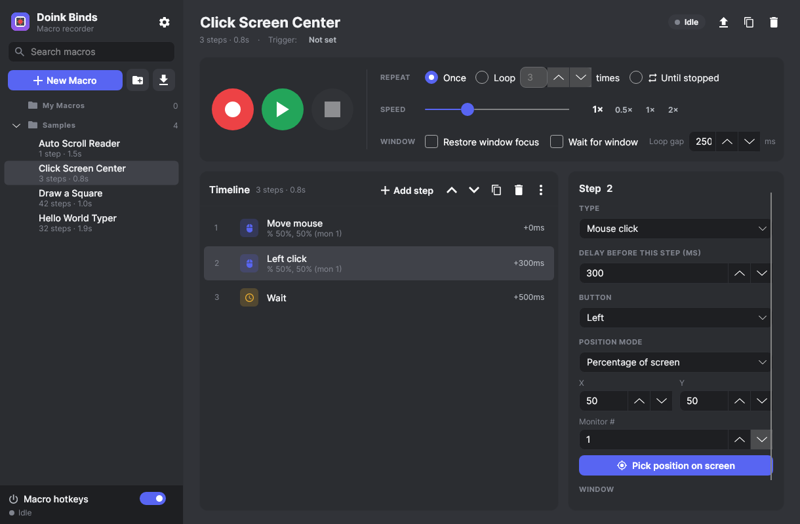

# Doink Binds

**Doink Binds** is a mouse and keyboard macro recorder and player for **Windows and macOS**. It records clicks, keys, mouse movement, timings and the focused window, and replays them on demand. You can loop a macro, change its playback speed and bind it to a hotkey.

It can also **read the screen**: find an image, read text (built-in OCR, no internet needed), check a pixel's colour or notice a window opening, and then act on it. Write "**when this happens, do that**" rules that watch in the background, put **If / Else / Loop** steps inside macros, build macros with a **guided recorder**, arrange your apps with saved **window layouts**, and get **pass/fail test reports** with screenshots.

The dark interface is modeled on Discord and Notion. Under the hood the app uses MVVM and native OS hooks.



---

## 1. Tech stack

| Concern | Choice | Why |
|---|---|---|
| UI | **Avalonia UI 11.3** (Fluent theme + custom Discord-style theme) | Native-feeling, GPU-rendered UI that runs the same on Windows and macOS, and has full Visual Studio / Rider support |
| Language / runtime | **C# 12 / .NET 8 (LTS)** | Fast, mature, and publishes as a self-contained single file |
| Architecture | **MVVM** with **CommunityToolkit.Mvvm** + **Microsoft.Extensions.DependencyInjection** | Source-generated observable properties and commands; services are swappable and testable |
| OS integration | Hand-written P/Invoke: **Win32** (`WH_KEYBOARD_LL`, `WH_MOUSE_LL`, `SendInput`) and **macOS CoreGraphics** (`CGEventTap`, `CGEventPost`, `NSWorkspace`) | No third-party native dependencies, and you control every timing-critical detail |
| Data | JSON **`.doink`** files (System.Text.Json) | Human-readable, versioned, easy to share |
| Screen reading | GDI `BitBlt` (Windows) / `CGDisplayCreateImageForRect` (macOS), a hand-written template matcher, and **PaddleOCR PP-OCRv4** models on **ONNX Runtime** | Fully offline and bundled in the app — nothing to install, nothing sent anywhere |
| Window management | Win32 `EnumWindows`/`SetWindowPos`, macOS `CGWindowList` + Accessibility (`AXUIElement`) | Move, resize, focus, minimise and close other apps' windows |
| Tests | xUnit with a fake platform and a fake screen | The recorder, player, flow control, OCR, image matching, rules, layouts, editor and library are verified headlessly |

---

## 2. Features

- **Recording**: mouse movement (with configurable sampling), left/right/middle/back/forward clicks, scroll wheel, key down and up, exact millisecond delays, and the foreground app and window title for each action.
- **Four mouse positioning modes**, chosen per step and convertible at any time:
  - **Absolute**: desktop x, y coordinates. Works across monitors, including ones at negative coordinates.
  - **Relative**: an offset from wherever the cursor is when the step plays.
  - **Percentage**: 0 to 100 % of a monitor, so a macro works at any resolution. If the monitor it was recorded on is unplugged, the primary monitor is used.
  - **Pin-point**: pick a position visually with a crosshair overlay that covers every monitor. Arrow keys nudge it by 1 px (Shift+arrow by 10 px).
- **Playback**: play once, loop N times, or loop until stopped. Speed runs from **0.25× to 3.0×**, you can set a gap between loops, and you can pause or resume. Steps are scheduled on a drift-free timeline with sub-millisecond waits.
- **Window awareness**: playback can bring the recorded app back to the front and/or wait until it is focused (the timeout is configurable).
- **Safety**: every key and mouse button a macro holds down is released when it stops, finishes or errors. Doink Binds never re-records or reacts to its own injected input.
- **Hotkeys**: fully remappable key combinations. Each one can be **Global** or **Only when Doink Binds is focused**.
  - Defaults: **F6** record/stop · **F7** play/pause · **F8** toggle macros on/off · **F9** stop playback
  - Each macro can also have its own **trigger hotkey**. Pressing it again while that macro plays stops it.
- **Macro library**: folders, search, rename, duplicate, move, delete, and **import/export of `.doink` files**. Changes auto-save.
- **Timeline editor**: shows every step. You can edit delays, positions, buttons, keys and scroll amounts, and you can reorder, duplicate, delete or insert steps. Bulk tools remove all mouse moves, scale all delays, or convert all positions to another mode.
- **Feedback**: a floating always-on-top indicator (it never steals focus), a live view of recorded actions, the current step highlighted during playback, and toasts.
- **Humanize**: random ± timing and ± mouse jitter per macro, so playback doesn't look robotic. **Repeat for N minutes** as well as N times.
- **Settings**: hotkeys and their scopes, default mouse mode, monitor awareness, sampling rate and jitter filter, recording countdown, scan-code mode for games (Windows), minimize while recording or playing, and a dark, light or system theme.

### Screen reading & automation (new)

- **Conditions** — what Doink Binds can "see":
  - **Image is on screen** — capture a picture of a button/icon by dragging a box; it's found again even if it moves.
  - **Text is on screen** — built-in OCR (English letters and numbers). Contains / equals / starts with / regex / number compare (e.g. "score > 1000").
  - **Pixel colour** and **area colour** (with tolerance and "% of the area").
  - **Window exists** / **window is focused**.
  - **Variable** compare (numbers or text).
  - Combine them with **AND / OR / NOT** groups. Every condition can be limited to an area (dragged on screen) and can follow a window when it moves. A **Test** button shows the result straight away.
- **Rules** (Rules tab) — *When this happens, do that*, running in the background:
  - Fire once each time the condition becomes true, or repeatedly while it stays true.
  - Check interval per rule (how fast it watches), cooldown, stop after N times, skip while a macro is playing.
  - THEN steps use the same editor as macros: run a macro, click where the thing was found, type, notify, window actions, …
  - **F10** (or the switch at the bottom of the sidebar) turns watching on/off.
- **New step types in macros** (Add step menu):
  - Flow: **If / Else / End If**, **Loop** (N times, while, until, forever) / **End Loop**, **Break**, **Stop macro**, **Run another macro**.
  - Screen: **Wait for** (image / text / colour / window, with a timeout), **Find & click** (image or text), **Read text into a variable**, **Check** (a test assertion), **Screenshot**.
  - Other: **Type text** (any characters, emoji included), **Random wait**, **Set variable** (set / add / subtract / append, with `{name}` placeholders and `{date}`, `{time}`, `{random:1-10}`…), **Notify**, **Open app / file / website**, **Window action**, **Comment**.
  - Clicks can go to a fixed position, a position **inside a window**, or **where the image/text was found** (with an offset).
  - When a step fails (e.g. the image never appeared) the macro **stops and shows an error** by default; per step you can choose *skip* or *retry* instead.
- **Window layouts** (Layouts tab): save where your apps are, then restore it with one click, a hotkey, or a macro step. Apps that aren't running are started automatically and the layout waits for them.
- **Test reports** (Reports tab): every run with Check steps (or with *Always save a run report*) writes a report with PASS/FAIL per check and a screenshot of every failure. Open it in the browser as HTML.

### Building macros (new)

- **Guided recording** (wand button, or **Shift+F6**), in a small always-on-top window:
  - **Step by step** — pick each action from a list (click, type, key combo, wait, wait for image/text, check, open app, screenshot…) and point at the screen. Nothing is recorded by accident.
  - **Record, pausing after each click** — use your computer normally; after every click you can name the step, turn it into "click this image", add a wait or a condition, take a screenshot, or undo it.
- **Manual building**: categorised **Add step** menu with forms, **Templates** (Auto-clicker, Click an image when it appears, Refresh until text appears, Fill in a login form, If image is visible … else …, Repeat with a counter, Keep awake, Screenshot every minute, Open app and wait for its window, Test: check text is shown), **drag & drop** reordering, multi-select, **copy / cut / paste** (also between macros), **undo / redo** (Ctrl+Z / Ctrl+Y). Steps inside If / Loop blocks are indented, and a banner warns about a missing End If / End Loop.
- **Tray icon**: closing the window keeps hotkeys and rules running in the tray. Optional *start with Windows/macOS* and *start hidden*.

---

## 3. Project structure

```
BINDS/
├─ DoinkBinds.sln                  ← open this in Visual Studio / Rider
├─ README.md
├─ global.json, Directory.Build.props
├─ samples/                        ← sample .doink macros (installed into the library on first run)
├─ build/
│  ├─ publish-windows.ps1          ← single-file exe (+ optional installer)
│  ├─ package-macos.sh             ← .app bundle + .dmg
│  ├─ windows/DoinkBinds.iss       ← Inno Setup installer script (+ .doink file association)
│  └─ macos/Info.plist, doink.icns
├─ .github/workflows/build.yml     ← CI: tests, Windows exe/installer, macOS dmg
├─ tests/DoinkBinds.Tests/         ← xUnit tests with a fake platform
└─ src/DoinkBinds/
   ├─ Program.cs, App.axaml(.cs)   ← entry point, DI composition root, global error handling
   ├─ app.manifest                 ← Per-Monitor-V2 DPI awareness (exact pixel coordinates)
   ├─ Assets/                      ← icons
   ├─ Styles/                      ← Colors (dark + light), Icons, Theme (controls, animations)
   ├─ Models/                      ← Macro, MacroAction, MousePosition, Hotkey, AppSettings, KeyCodes…
   ├─ Platform/
   │  ├─ IPlatform.cs              ← IInputHook, IInputSimulator, IWindowService, IScreenService
   │  ├─ InputHookBase.cs          ← fast-callback → queue → dispatcher thread
   │  ├─ Windows/                  ← Win32 hooks, SendInput, window focus, monitors
   │  ├─ MacOS/                    ← CGEventTap, CGEventPost, NSWorkspace, key-code mapping
   │  └─ Null/                     ← fallback for unsupported OSes (UI still works)
   ├─ Services/
   │  ├─ MacroRecorderService.cs   ← IMacroRecorderService
   │  ├─ MacroPlayerService.cs     ← IMacroPlayerService
   │  ├─ HotkeyService.cs          ← IHotkeyService
   │  ├─ MacroLibraryService.cs    ← IMacroLibraryService
   │  ├─ MousePositionService.cs   ← IMousePositionService (+ IPinPointPicker / IScreenPicker)
   │  ├─ Automation/               ← ScreenVision (conditions), RuleEngine, LayoutService,
   │  │                               ReportService, AutomationStore, Variables
   │  ├─ SettingsService.cs, LogService.cs, AppPaths.cs, UiServices.cs
   ├─ Vision/                      ← BgraImage, ImageMatcher, OcrEngine (PaddleOCR on ONNX Runtime)
   ├─ Ocr/                         ← det.onnx + rec.onnx (embedded in the app)
   ├─ ViewModels/                  ← MainWindow, Macro, Action (step), Condition, Rules, Layouts,
   │                                  Reports, Guide, StepFactory (templates), Folder, Settings
   ├─ Views/                       ← MainWindow, MacroEditorView, StepEditorView, ConditionEditorView,
   │                                  Rules/Layouts/ReportsPageView, GuideWindow, RegionPickerWindow,
   │                                  NotificationWindow, SettingsView, PinPointOverlayWindow,
   │                                  StatusIndicatorWindow, DialogWindow + Dialog/Shell/PinPoint services
   ├─ Converters/
   └─ Properties/PublishProfiles/  ← win-x64, win-arm64, osx-arm64, osx-x64
```

---

## 4. Building

### Requirements
- **.NET 8 SDK** or newer: <https://dotnet.microsoft.com/download>
- **Windows:** Visual Studio 2022 (17.8+) with the *.NET desktop development* workload. Optionally install the [Avalonia extension](https://marketplace.visualstudio.com/items?itemName=AvaloniaTeam.AvaloniaVS) for the XAML previewer.
- **macOS:** JetBrains Rider, VS Code with C# Dev Kit, or the command line.

### Visual Studio (Windows)
1. Open **`DoinkBinds.sln`**.
2. Set **DoinkBinds** as the startup project.
3. Press **F5**.

### Command line (any OS)
```bash
dotnet build                        # build everything
dotnet run --project src/DoinkBinds # run the app
dotnet test                         # run the unit tests
```

---

## 5. Publishing a real downloadable app

All publish profiles produce a **self-contained** build: the end user doesn't need to install .NET.

### Windows → `DoinkBinds.exe` (single file)
**In Visual Studio:**
1. Right-click the **DoinkBinds** project and choose **Publish…**.
2. Pick the **win-x64** (or **win-arm64**) profile and click **Publish**.

**Command line:**
```powershell
dotnet publish src/DoinkBinds/DoinkBinds.csproj -p:PublishProfile=win-x64
# → publish\win-x64\DoinkBinds.exe   (runs on any Windows 10/11 x64 PC; the OCR engine is included)
```

**Installer.** This needs [Inno Setup 6](https://jrsoftware.org/isinfo.php). It produces `publish\DoinkBinds-Setup-win-x64.exe`, which creates Start-menu and desktop shortcuts and registers the `.doink` file association:
```powershell
.\build\publish-windows.ps1 -Installer
```

### macOS → `Doink Binds.app` + `.dmg`
```bash
./build/package-macos.sh            # Apple Silicon (osx-arm64)
./build/package-macos.sh osx-x64    # Intel Macs
# → publish/osx-arm64/Doink Binds.app  and  publish/DoinkBinds-osx-arm64.dmg
```
The script publishes the app, assembles the bundle (Info.plist, icon, native libraries, samples), signs it ad-hoc and builds a DMG.

To distribute outside your own Mac, sign with your Developer ID and notarize:
```bash
codesign --force --deep --options runtime --sign "Developer ID Application: <you>" "publish/osx-arm64/Doink Binds.app"
xcrun notarytool submit publish/DoinkBinds-osx-arm64.dmg --keychain-profile <profile> --wait
```

### CI and downloads
`.github/workflows/build.yml` runs the tests and then builds the Windows installers and the macOS DMGs (Intel and Apple Silicon) on every push. It then publishes them on the repository's **Releases** page: branch pushes update the **"latest"** pre-release, and pushing a `v*` tag (e.g. `v1.1.0`) creates a normal versioned release.

- **Windows:** `DoinkBinds-Setup-Windows.exe` is a normal setup wizard. It installs per user without admin rights, adds Start-menu and desktop shortcuts, associates `.doink` files, and has an uninstaller in *Settings → Apps*. The app isn't code-signed, so SmartScreen may show "Windows protected your PC". Click **More info → Run anyway**.
- **macOS:** open the `.dmg` and drag **Doink Binds** onto the **Applications** shortcut. The first time, right-click the app and choose **Open**, because the app is only ad-hoc signed.

---

## 6. First run & permissions

| OS | What to do |
|---|---|
| **Windows** | Nothing. To automate an app that runs **as Administrator**, Doink Binds must also run as Administrator. Windows blocks input injection into elevated windows (UIPI). |
| **macOS** | On first launch, macOS asks for **Input Monitoring** (needed to record and for hotkeys) and **Accessibility** (needed to play back and to move other apps' windows). Screen reading (images, text, colours) also needs **Screen Recording**. Enable *Doink Binds* in **System Settings → Privacy & Security** under both lists, then restart the app. A yellow banner explains what's missing. Settings has a **Request access** button. |
| **Linux** | The UI and library work, but recording and playback are not implemented (no global hook backend yet). |

---

## 7. Using Doink Binds

1. **Record:** press **F6** or the red button. Use your computer normally, then press **F6** again.
   - If the selected macro is empty, the recording goes into it. Otherwise a new macro named "Recording …" is created, so existing work is never overwritten.
   - Clicks and keys inside Doink Binds itself are ignored, so clicking **Stop** isn't recorded.
   - You can turn on a countdown in Settings to get time to switch windows.
2. **Play:** press **F7** or the green button. Choose **Once**, **Loop N times** or **Until stopped**, and set the speed.
   - **F7** pauses and resumes.
   - **F9** always stops playback, even when macros are toggled off.
3. **Toggle:** **F8** (or the switch at the bottom of the sidebar) turns all macro hotkeys on or off. The F8 key itself always works.
4. **Trigger hotkeys:** click **Trigger: Not set** under a macro's name and press a key combination. That combination now plays the macro from anywhere.
5. **Edit:** select steps in the timeline.
   - Change the delay, type, button, key or position. Use **Pick position on screen** for pixel-perfect placement.
   - Keyboard: **Del** deletes a step, **Alt+↑/↓** moves it, **Ctrl+D** duplicates it.
   - **Add step → Click at picked position…** builds a click macro without recording.
6. **React to the screen:** in the Rules tab click **New rule → Click an image when it appears**, press **Capture from screen**, drag a box around the button, then switch on **Watch the screen** (F10).
7. **Test an app:** add **Check** steps (Add step → Testing). Every run then writes a PASS/FAIL report with screenshots in the Reports tab.
8. **Organize:** create folders, right-click macros to rename, duplicate, move, export or delete them, and search from the sidebar. Use **Import** (Ctrl+I) for `.doink` files from friends.

### Tips
- **Different screen sizes?** Set *Default mouse position mode* to **Percentage of screen** before recording, or convert an existing macro with **⋮ → Convert all positions to → Percentage**.
- **Games ignoring keys?** On Windows, turn on **Settings → Send keys as scan codes**.
- **Huge recordings?** Raise the movement sample interval, or use **⋮ → Remove all mouse moves** if only the clicks matter.

---

## 8. The `.doink` file format

Plain, indented JSON. Version 1:

```jsonc
{
  "format": "doink",
  "version": 1,
  "app": "Doink Binds",
  "macro": {
    "id": "7e0b…",                    // regenerated on import
    "name": "Click Screen Center",
    "folder": "",
    "description": "…",
    "triggerHotkey": { "keyCode": 121, "modifiers": "Control, Shift" },   // or null
    "playback": { "mode": "LoopCount", "loopCount": 3, "speed": 1.0,
                  "restoreWindowFocus": true, "waitForWindow": false, "loopDelayMs": 250 },
    "actions": [
      { "type": "MouseMove",  "delayMs": 0,   "position": { "mode": "Percentage", "x": 50, "y": 50, "monitorIndex": 0 } },
      { "type": "MouseClick", "delayMs": 300, "button": "Left", "position": { "mode": "Absolute", "x": 960, "y": 540, "monitorIndex": 0 } },
      { "type": "KeyPress",   "delayMs": 100, "keyCode": 65, "window": { "processName": "notepad", "title": "Untitled - Notepad" } },
      { "type": "MouseWheel", "delayMs": 50,  "wheelDelta": -120, "horizontal": false },
      { "type": "Wait",       "delayMs": 1000 }
    ]
  }
}
```

- **`type`**: `MouseMove`, `MouseDown`, `MouseUp`, `MouseClick`, `MouseWheel`, `KeyDown`, `KeyUp`, `KeyPress`, `Wait`, and the automation steps `TypeText`, `RandomWait`, `RunMacro`, `OpenApp`, `WindowAction`, `WaitFor`, `FindAndClick`, `If`, `Else`, `EndIf`, `Loop`, `EndLoop`, `Break`, `SetVariable`, `ReadText`, `Check`, `Notify`, `Screenshot`, `Comment`, `StopMacro`.
- **`condition`** (on `If`, `WaitFor`, `FindAndClick`, `Check`, `Loop` while/until): `{ "type": "TextVisible", "text": "Victory", "match": "Contains", "region": {…} }`. Groups use `"type": "All"` / `"Any"` with `children`; `"negate": true` means NOT. Captured images are stored inline as base64 PNG, so a `.doink` file is self-contained.
- Importing a macro that opens apps or closes windows asks for confirmation first.
- **`delayMs`**: the wait before the step, at 1× speed.
- **`keyCode`**: a platform-neutral key code. It uses Windows virtual-key numbering; macOS key codes are translated automatically.
- **`position.mode`**: `Absolute`, `Relative`, `Percentage` or `PinPoint`. For `Percentage`, `monitorIndex: -1` means a percentage of the whole desktop.
- **`wheelDelta`**: 120 per wheel notch. Positive scrolls up or right.

---

## 9. Architecture notes (for contributors)

- **Hook pipeline.** OS hook callbacks (`WindowsInputHook`, `MacInputHook`) timestamp each event with `Stopwatch` and push it onto a queue. A dispatcher thread (`InputHookBase`) then fans events out to `HotkeyService` and `MacroRecorderService`. This keeps callbacks well under Windows' `LowLevelHooksTimeout` and macOS' tap timeout. It also means recorded delays reflect the true event times, not processing time.
- **Synthetic input tagging.** Every event Doink Binds injects is marked: `dwExtraInfo` on Windows, `kCGEventSourceUserData` on macOS. The hook flags these as `IsSynthetic`, so playback is never recorded and never triggers hotkeys.
- **Player timing.** Each loop iteration is scheduled against an absolute `Stopwatch` timeline: coarse waits followed by a short spin, with `timeBeginPeriod(1)` on Windows, so per-step overhead never adds up to drift. Pausing, and time spent waiting for a window, shift the timeline instead of compressing later steps.
- **Coordinates.** The app is Per-Monitor-V2 DPI aware on Windows (physical pixels everywhere). On macOS it uses CoreGraphics global points. `MousePositionService` does all the mode math and clamps every resolved point onto a real monitor, including layouts with gaps.
- **Adding a platform** (for example Linux/X11): implement `IPlatformServices` (hook, simulator, windows, screens) and return it from `PlatformFactory`.
- **Adding an action type:** add it to `MacroActionType`, then handle it in `MacroPlayerService.Execute`, in `ActionViewModel.Title`, in `StepFactory`, and in the "Add step" menu.
- **Flow control.** The player is a program-counter runner. `BlockMap` pairs If/Else/End If and Loop/End Loop once per run, and reports structure errors with step numbers.
- **Screen reading.** `ScreenVision` evaluates condition trees with one screen capture per check (cached across the tree). Image matching works at full resolution with early-rejecting probe pixels (a few ms on a 1080p screen). OCR runs text detection + recognition; small areas skip detection.
- **Rules** are evaluated on a background timer (`RuleEngine`); their THEN steps run through the normal player.
- **Data location:** `%APPDATA%\DoinkBinds` on Windows and `~/Library/Application Support/DoinkBinds` on macOS. Override it with the `DOINK_DATA_DIR` environment variable, or put an empty `portable.txt` next to the executable to store data in `./Data` (portable mode). A log file is written to `doink.log` in the data folder.

## 10. Known limitations

- Hotkeys are observed, not swallowed: the key press still reaches the focused app. Pick combinations that apps don't use (the F-keys are a good default).
- Keys bound as Doink Binds hotkeys are excluded from recordings.
- On macOS, other apps' window titles need Screen Recording permission, so window matching uses the application name.
- Linux has no input backend yet.
- OCR is tuned for English letters and numbers; very small or stylised game fonts may read imperfectly — limit the area and use "contains" matching.
- Finding an image is pixel-based: if the button changes size (different zoom/DPI) re-capture it, or lower the similarity.

---

## 11. Third-party notices

- **PaddleOCR PP-OCRv4** detection/recognition models (via the RapidOCR distribution) — Apache License 2.0.
- **ONNX Runtime** — MIT License.
- **SkiaSharp**, **Avalonia**, **CommunityToolkit.Mvvm** — MIT License.
- Tests use the **Inter** font — SIL Open Font License 1.1.
